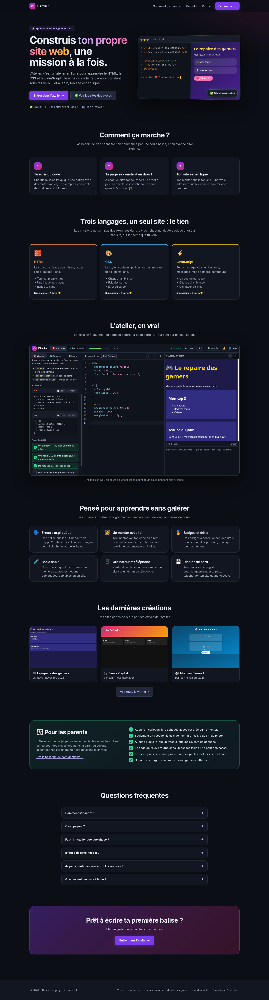

# 🛠️ L'Atelier

Un mini site pour apprendre le développement web **en construisant son propre site**.
L'élève écrit du HTML, puis du CSS, puis du JavaScript, et voit sa page se construire en direct.
Le mentor suit tout en temps réel, débloque les étapes et publie le site final.

- **Mode Missions** : 19 petites missions guidées (8 HTML, 6 CSS, 5 JS) + 6 **défis bonus ⭐**, avec checklist automatique, indices et célébration.
- **Mode Bac à sable** : l'élève construit ce qu'il veut, avec un mémo (lexique, balises, propriétés, bouts de JS) copiable en un clic.
- **Aides pour l'élève** : erreurs JS **et HTML** expliquées en français (et soulignées dans l'éditeur), aperçu ordinateur ou 📱 téléphone, quiz d'échauffement, 15 badges.
- **Panneau mentor** (`/mentor`) : déblocages, vue en direct (code, aperçu, console, checklist), **montrer une ligne** à l'élève d'un clic, messages et indices, quiz, progression, **historique des versions** restaurable, **notes privées**, publication.
- **Sites publiés** : `/site/<pseudo>`, une copie figée avec QR code, compteur de visites anonyme, téléchargement en .zip, et **vitrine** publique facultative (`/vitrine`).
- **Sauvegardes** quotidiennes chiffrées, vérifiées et tournantes, plus des **alertes Discord** (optionnelles).
- **Pages publiques** : page d'accueil, vitrine, mentions légales, politique de confidentialité et conditions d'utilisation.

| Adresse | Page |
|---|---|
| `/` | Page d'accueil publique (présentation, dernières créations, FAQ, parents) |
| `/connexion` | Connexion de l'élève avec son code (`/entree` y redirige) |
| `/e/<code>` | Lien personnel : connecte directement l'élève |
| `/atelier` | L'atelier de l'élève (connexion obligatoire) |
| `/mentor` | Panneau mentor |
| `/vitrine` | Les sites cochés par le mentor |
| `/site/<pseudo>` | Le site publié d'un élève |
| `/mentions-legales`, `/confidentialite`, `/conditions` | Pages légales |



---

## Sommaire

1. [Lancer en local](#1-lancer-en-local)
2. [Déployer sur le NAS TrueNAS Scale](#2-déployer-sur-le-nas-truenas-scale)
3. [Sauvegardes et restauration](#3-sauvegardes-et-restauration)
4. [Cloudflare Tunnel (latelier.juleslfl.dev)](#4-cloudflare-tunnel-latelierjuleslfldev)
5. [Alertes Discord](#5-alertes-discord)
6. [Ajouter ou modifier une mission](#6-ajouter-ou-modifier-une-mission)
7. [Utilisation pendant une séance](#7-utilisation-pendant-une-séance)
8. [Sécurité et données](#8-sécurité-et-données)
9. [Organisation du code](#9-organisation-du-code)
10. [Publier le code sur GitHub](#10-publier-le-code-sur-github)

---

## 1. Lancer en local

Prérequis : **Node.js 22** ou plus. (Pour tester avec Docker en local : `docker network create web_tunnel` une seule fois.)

```bash
npm install
cp .env.example .env
```

Dans `.env`, remplis au minimum :

```ini
MENTOR_PASSWORD=un-mot-de-passe-solide
SESSION_SECRET=<résultat de : openssl rand -hex 32>
PUBLIC_URL=http://localhost:3000
PORT=3000
```

Puis :

```bash
npm run dev        # serveur + interface avec rechargement automatique (Vite)
# ou, comme en production :
npm run build && npm start
```

- Page d'accueil : <http://localhost:3000>
- Atelier de l'élève : <http://localhost:3000/atelier> (redirige vers `/connexion` si pas connecté)
- Panneau mentor : <http://localhost:3000/mentor>

Dans le panneau mentor, clique sur **« + Nouveau »**, choisis un pseudo : tu obtiens le **lien personnel** de l'élève.

### Tests

```bash
npm test                                 # serveur, sauvegardes, règles, missions, vérificateur HTML, erreurs en français (~5 s)
npm run build && npm run test:navigateur # tests dans un vrai navigateur (~1 min)
```

`test:navigateur` pilote **le Firefox déjà installé** sur ta machine, en mode invisible (rien n'est téléchargé). Il vérifie :

- pour chacune des 25 missions et défis : la solution de référence la réussit, l'étape d'avant ne la réussit pas, et les erreurs classiques ne la valident pas ;
- le parcours de l'élève : ouverture du lien → première balise → mission réussie (en environ 4 secondes), badges, quiz, aperçu téléphone, « Mon site » ;
- l'isolation de l'aperçu : pas d'accès aux cookies, à l'application, à l'API ;
- les erreurs JS et HTML expliquées en français, la protection contre les boucles infinies ;
- le panneau mentor : vue en direct, ligne montrée, déblocage, publication, vitrine, historique, notes, sauvegarde chiffrée.

Les captures d'écran sont enregistrées dans `tests/navigateur/captures/`.

```bash
npm run build && npm run captures         # captures de démonstration (élèves et sites fictifs)
```

`captures` lance l'Atelier avec trois élèves fictifs, puis capture l'atelier (l'image `client/public/images/apercu-atelier.png` affichée sur la page d'accueil) et toutes les pages publiques, sur ordinateur et sur téléphone. Refais-le après avoir changé le design de l'atelier, puis `npm run build`.

---

## 2. Déployer sur le NAS TrueNAS Scale

L'image est construite **à partir du repo** (Dockerfile multi-étapes : installation, tests, build, puis image finale légère).
La base SQLite est dans un **volume persistant** (`atelier-donnees`) : elle survit aux mises à jour.

### Option A : Portainer (recommandé)

1. Portainer → **Stacks** → **Add stack** → **Repository**.
2. **Repository URL** : l'URL de ton repo GitHub (s'il est privé, ajoute un *Personal Access Token* GitHub en lecture seule dans « Authentication »).
3. **Compose path** : `docker-compose.yml`.
4. **Environment variables** (en bas), ajoute :

   | Variable | Valeur |
   |---|---|
   | `MENTOR_PASSWORD` | ton mot de passe mentor |
   | `SESSION_SECRET` | 64 caractères aléatoires (`openssl rand -hex 32`) |
   | `PUBLIC_URL` | `https://latelier.juleslfl.dev` |
   | `PORT` | `30085` (accès depuis la maison : `http://IP-DU-NAS:30085`) |
   | `SAUVEGARDE_CLE` | **conseillé** : `openssl rand -base64 32` (voir [Sauvegardes](#3-sauvegardes-et-restauration)) |
   | `CHEMIN_SAUVEGARDES` | *(facultatif)* un dossier du NAS pour les sauvegardes, ex. `/mnt/NAS/sauvegardes/atelier` |
   | `DISCORD_WEBHOOK_URL` | *(facultatif)* voir [Alertes Discord](#5-alertes-discord) |

5. **Deploy the stack**. Le premier build prend quelques minutes (le bouton tourne pendant ce temps, c'est normal).
6. Vérifie : `http://IP-DU-NAS:30085/mentor`.

**Mettre à jour** après un `git push` : stack → **Pull and redeploy** (coche « Re-pull image and redeploy »). L'image est toujours construite sur place (`pull_policy: build`), jamais téléchargée.
Si la structure de la base change dans une nouvelle version, une **sauvegarde chiffrée est faite automatiquement avant** la migration ; si elle échoue, le site refuse de démarrer plutôt que de toucher à la base.

### Option B : en SSH sur le NAS

```bash
git clone https://github.com/<toi>/atelier.git
cd atelier
cp .env.example .env
nano .env                  # remplis MENTOR_PASSWORD, SESSION_SECRET, PUBLIC_URL, PORT
docker compose up -d       # construit l'image et lance le site
```

Mettre à jour : `git pull && docker compose up -d --build`.

### Où sont les données ?

Dans le volume Docker `atelier_atelier-donnees` (fichier `atelier.db`). Pour utiliser plutôt un **dataset** TrueNAS (pratique pour les snapshots), remplace dans `docker-compose.yml` :

```yaml
    volumes:
      - /mnt/tank/apps/atelier:/data
```

et donne le dossier à l'utilisateur du conteneur (UID 1000) : `chown -R 1000:1000 /mnt/tank/apps/atelier`.

Les **sauvegardes** sont dans un autre volume (`atelier_atelier-sauvegardes`), ou dans `CHEMIN_SAUVEGARDES` : voir la section suivante.

### Durcissement du conteneur (déjà configuré)

L'application tourne avec un utilisateur non-root, sur un système de fichiers en lecture seule (sauf `/data` et `/sauvegardes`, en droits `700`), avec `no-new-privileges` et un *healthcheck* sur `/api/sante`. Un `docker stop` enregistre le code en cours avant de quitter.

---

## 3. Sauvegardes et restauration

Une sauvegarde **automatique par jour** (14 gardées), plus celles que tu lances depuis le panneau mentor (**⚙️ Système → Sauvegarder maintenant**).

### Ce qui est fait à chaque sauvegarde

1. **Copie cohérente** de la base en mémoire, sans arrêter le site.
2. **Contrôle d'intégrité** SQLite de la copie (une base abîmée n'est jamais sauvegardée comme si de rien n'était).
3. **Chiffrement AES-256-GCM** si `SAUVEGARDE_CLE` est définie : clé dérivée par *scrypt*, sel et IV aléatoires, toute modification du fichier est détectée au déchiffrement.
4. **Relecture** : le fichier chiffré est aussitôt déchiffré en mémoire et comparé à l'original (empreinte SHA-256).
5. **Écriture atomique** (fichier temporaire, `fsync`, renommage), droits `600`, dossier `700`, et un manifeste `.json` (date, empreintes, nombre d'élèves).
6. **Rotation** : 14 automatiques, 10 manuelles, 5 « avant migration », 5 « avant restauration ».

Il est **impossible de télécharger ou de restaurer une sauvegarde depuis le web** : c'est volontaire. Le panneau affiche seulement leur état, et une alerte (⚠️ en haut à droite, et sur Discord) si une sauvegarde échoue ou si elles ne sont pas chiffrées.

### La clé de chiffrement

```bash
openssl rand -base64 32
```

Mets le résultat dans `SAUVEGARDE_CLE` **et dans ton gestionnaire de mots de passe**. Sans cette clé, les sauvegardes chiffrées sont illisibles, même pour toi. Si tu la changes, les anciennes sauvegardes restent lisibles uniquement avec l'ancienne clé.

### Où les ranger

Idéalement **ailleurs que la base** : un dataset du NAS, avec ses propres snapshots, et pourquoi pas une tâche de réplication TrueNAS vers un disque externe.

```bash
mkdir -p /mnt/NAS/sauvegardes/atelier && chown -R 1000:1000 /mnt/NAS/sauvegardes/atelier && chmod 700 /mnt/NAS/sauvegardes/atelier
```

puis `CHEMIN_SAUVEGARDES=/mnt/NAS/sauvegardes/atelier` dans les variables de la stack.

### Restaurer (site arrêté)

Dans TrueNAS › **System** › **Shell** (ces commandes marchent que la stack ait été créée par Portainer ou en ligne de commande) :

```bash
# 1. Voir les sauvegardes (site en marche)
docker exec atelier node serveur/outils/sauvegardes.js liste

# 2. Arrêter le site
docker stop atelier

# 3. Restaurer : on reprend les volumes du conteneur et sa clé, sans la retaper
CLE=$(docker inspect atelier --format '{{range .Config.Env}}{{println .}}{{end}}' | sed -n 's/^SAUVEGARDE_CLE=//p')
docker run --rm --volumes-from atelier -e SAUVEGARDE_CLE="$CLE" atelier:latest \
  node serveur/outils/sauvegardes.js restaurer <nom-du-fichier>

# 4. Relancer
docker start atelier
```

Pour seulement tester qu'une sauvegarde est lisible : `docker exec atelier node serveur/outils/sauvegardes.js verifier <nom>`.

L'outil refuse de restaurer si le site tourne encore. Il vérifie la sauvegarde (déchiffrement + intégrité), **met la base actuelle de côté** (sauvegarde « avant-restauration ») puis remplace la base. Rien n'est perdu, même en cas d'erreur de choix.

---

## 4. Cloudflare Tunnel (latelier.juleslfl.dev)

Le site passe par le **tunnel Cloudflare déjà en place sur le NAS** (conteneur `cloudflared`, tunnel « géré localement »). Aucun port n'est ouvert sur la box, et le temps réel (WebSocket) passe par le tunnel sans réglage particulier.

La stack rejoint le réseau Docker **`web_tunnel`** (déclaré `external` dans `docker-compose.yml`). Le tunnel joint donc l'Atelier à l'adresse **`http://atelier:3000`**, avec le nom du conteneur.

### a) Déclarer l'adresse dans le tunnel

TrueNAS › **System** › **Shell** :

```bash
sudo nano /mnt/NAS/cloudflared/config.yml
```

Ajoute la règle **avant** la dernière ligne (`- service: http_status:404`, qui doit toujours rester en dernier) :

```yaml
  - hostname: latelier.juleslfl.dev
    service: http://atelier:3000
```

Puis redémarre le conteneur `cloudflared` dans Portainer. Ses logs doivent afficher `Registered tunnel connection`.

### b) Créer l'entrée DNS

Cloudflare › `juleslfl.dev` › **DNS** › **Records** › **Add record** :

| Type | Nom | Cible | Proxy |
|---|---|---|---|
| `CNAME` | `latelier` | `<identifiant-du-tunnel>.cfargotunnel.com` (la même cible que les autres sous-domaines) | ✅ Proxied (nuage orange) |

> Le sous-domaine est libre tant qu'aucun enregistrement `latelier` n'existe déjà dans ta zone DNS. Si tu en choisis un autre, change aussi `PUBLIC_URL`.

### c) Réglages Cloudflare à vérifier

- **WebSockets** : `juleslfl.dev` › **Network** › *WebSockets* = **On** (valeur par défaut). Sans ça, le direct passe par le *polling* : ça marche, mais c'est moins réactif.
- **Rocket Loader** et **Email Address Obfuscation** : à **désactiver** pour `latelier.juleslfl.dev` (*Rules* › *Configuration Rules*). Ils modifient le HTML et le JavaScript des pages, y compris le site de l'élève.
- **Cache** : les fichiers de `/assets/` ont un nom qui change à chaque build, donc pas besoin de numéro de version. Les pages, l'API et `/site/*` sont envoyées avec `no-cache` ou `no-store`.
- *(Optionnel)* une **règle de pare-feu** (comme pour `admin.juleslfl.dev`) sur le chemin `/mentor` et `/api/mentor`, par exemple « bloquer hors de France ». Ne bloque **pas** `/`, `/e/*`, `/entree`, `/site/*` ni `/socket.io/*`, sinon l'élève et ses proches seraient bloqués.

L'application lit la vraie IP du visiteur dans l'en-tête `CF-Connecting-IP`, uniquement pour limiter les essais de mot de passe et de code. Cette IP n'est **jamais enregistrée**.

### Si tu n'as pas (encore) de tunnel

Crée un réseau `docker network create web_tunnel`, puis un conteneur `cloudflared` sur ce réseau. Il suffit ensuite de pointer un nom public vers `http://atelier:3000`. La documentation de Cloudflare explique les deux modes (tableau de bord ou fichier `config.yml`).

---

## 5. Alertes Discord

Facultatif. Dans ton serveur Discord : salon › ⚙️ **Modifier le salon** › **Intégrations** › **Webhooks** › **Nouveau webhook** › **Copier l'URL du webhook**, puis colle-la dans `DISCORD_WEBHOOK_URL`.

Tu reçois un message quand :

- un élève se connecte **alors qu'aucun mentor n'est connecté** (au plus toutes les 3 h) ;
- un élève **termine un module** ;
- un élève fait le **quiz d'échauffement** (avec son score) ;
- une **sauvegarde échoue**, ou la base semble abîmée au démarrage.

Seul le pseudo est envoyé (jamais le code ni les messages). L'adresse est vérifiée au démarrage (uniquement `https://discord.com/api/webhooks/…`), les redirections ne sont pas suivies et les messages ne peuvent mentionner personne. Test : **⚙️ Système → Envoyer un message de test**.

---

## 6. Ajouter ou modifier une mission

Tout est dans **un seul fichier** : [`contenu/missions.js`](contenu/missions.js). Son en-tête documente tous les champs.

```js
{
  id: 'css-7',                      // unique, ne plus le changer une fois utilisé
  module: 'css',                    // 'html', 'css' ou 'js'
  titre: 'Une ombre stylée',
  objectif: 'Ajoute une ombre à tes cartes.',
  explication: `La propriété \`box-shadow\` ajoute une **ombre**…`,
  exemple: '.carte {\n  box-shadow: 0 8px 20px rgba(0, 0, 0, 0.4);\n}',
  indices: ['Indice 1…', 'Indice 2, plus précis…'],
  memo: [{ terme: 'box-shadow', categorie: 'propriete', definition: 'Une ombre.', exemple: '…' }],
  verifications: [
    { type: 'style', selecteur: '.carte', propriete: 'box-shadow', pasDefaut: true, label: 'Une ombre sur tes cartes' },
  ],
},
```

- **L'ordre dans le fichier = l'ordre des missions** dans chaque module.
- **Défi bonus** : ajoute `bonus: true`. Il ne bloque pas la suite et s'ouvre quand toutes les missions obligatoires du module sont réussies.
- **Quiz d'échauffement** : tout en bas du fichier (`export const quiz`), des questions rangées par mission : `{ question, choix: ['…', '…', '…'], reponse: 0, explication }` (`reponse` = position de la bonne réponse). Les réponses ne quittent jamais le serveur avant que l'élève ait répondu.
- **Mise en forme** des textes : `**gras**`, `*italique*`, `` `code` ``, ligne vide = paragraphe, `- ` = liste.
- **Vérifications disponibles** : `element`, `attribut`, `style`, `regleCss`, `console`, `clic`, `script` (ta propre fonction). Elles sont exécutées sur la vraie page de l'élève, dans un aperçu invisible.
- Elles doivent vérifier la **structure**, jamais un texte précis : chaque élève a son propre thème.

Ensuite :

```bash
npm test          # vérifie que le fichier est valide (le serveur refuse aussi de démarrer s'il y a une erreur, avec un message clair)
```

Puis redémarre le serveur, ou fais `git push` puis *Pull and redeploy* sur le NAS.

💡 Pour tester une nouvelle mission en conditions réelles, ajoute une étape dans `tests/navigateur/solutions.js` (le code attendu après la mission) et lance `npm run test:navigateur`.

---

## 7. Utilisation pendant une séance

1. **Avant la première séance** : `/mentor` → **+ Nouveau** → pseudo (pas de nom de famille). Copie le **lien personnel** et envoie-le à l'élève. Il n'est affiché qu'une fois, car il est stocké chiffré. Si l'élève le perd : onglet **Accès** → *Générer un nouveau lien*.
2. **Pendant la séance** : onglet **🔴 Direct**. Tu y vois le code, l'aperçu, la console (avec ses erreurs JS et HTML), la mission en cours, sa checklist et les indices utilisés.
   - **Clique sur un numéro de ligne** : elle est surlignée chez l'élève, avec une notification « Ton mentor te montre la ligne 12 ».
   - La barre du bas envoie un **message**, un **indice** (il reste affiché jusqu'à ce que l'élève le ferme) ou lance un **🧩 quiz** de 3 questions.
3. **Débloquer la suite** : onglet **🗺️ Parcours**. L'interrupteur d'un module ouvre ses missions, qui se débloquent ensuite une par une ; les **défis bonus ⭐** s'ouvrent quand le module est fini, sans bloquer la suite. Le menu *Accès* d'une mission force son ouverture ou sa fermeture. Le bouton *Valider* sert si une vérification automatique bloque injustement.
4. **Il a tout cassé ou tout effacé ?** Onglet **🕓 Historique** : une copie est faite à chaque début de séance et à chaque publication. Choisis une version, regarde l'aperçu, *Restaurer* : son éditeur se met à jour en direct (et le code d'avant est gardé).
5. **Après la séance** : onglet **📝 Notes** (privé, enregistré tout seul), bouton *+ Séance du jour*.
6. **Publier** : quand l'élève a demandé la publication (📣 à côté de son nom, et une notification), relis son site puis onglet **🌍 Publication** → *Publier le site*. C'est une **copie figée** : refais *Mettre à jour* pour publier les nouveautés. Tu peux l'ajouter à la **vitrine** publique, voir le nombre de visites et télécharger le .zip.

Côté élève :

- **A− / A+** règle la taille du code (pratique en partage d'écran Meet), **🖥️ / 📱** montre son site comme sur un ordinateur ou un téléphone ;
- **🏅** ses badges, **🌍 Mon site** le lien, le QR code à scanner, les visites et le téléchargement en .zip ;
- **🔔** les messages du mentor, **⟲** remet le code tel qu'il était au début de la mission (Ctrl+Z annule) ;
- au début d'une séance (au plus toutes les 6 h, dès 3 missions réussies), un **quiz d'échauffement** de 3 questions est proposé ; il peut le passer à plus tard.

---

## 8. Sécurité et données

**Données stockées** : un pseudo, le code de l'élève (et ses versions), sa progression, ses badges et scores de quiz, les messages et notes du mentor, les horaires de séance et un nombre de visites. **Pas** d'e-mail, pas de nom, pas d'IP, aucun traceur ni service tiers. Les polices sont hébergées par le site lui-même.

| Risque | Protection |
|---|---|
| Le JS de l'élève attaque l'application | Aperçu dans une `iframe srcdoc sandbox="allow-scripts"` **sans** `allow-same-origin`. Origine opaque : pas d'accès aux cookies, au DOM de l'app, ni à l'API (testé). Les messages de l'iframe sont filtrés par `event.source`. |
| Site publié servi sur le même domaine | En-tête `Content-Security-Policy: sandbox …` : la page publiée a aussi une origine opaque (testé avec un mentor connecté). |
| Boucle infinie qui gèle l'onglet | Le JS de l'élève est analysé avec le parseur de CodeMirror. Chaque boucle reçoit une garde qui l’arrête si elle tourne plus de 1,5 s (2 s sur le site publié). |
| Vol de session / CSRF | Cookies signés HMAC, `HttpOnly`, `SameSite=Strict`, `Secure` en HTTPS. En-tête `X-Atelier` obligatoire sur toute modification. WebSocket refusé s'il vient d'un autre site. |
| Deviner un code d'accès | Codes aléatoires d'environ 59 bits, stockés hachés (HMAC). 10 essais par quart d'heure et par IP. Régénérer un code coupe immédiatement l'ancienne session. |
| Données invalides ou énormes | Tout est revérifié côté serveur : tailles (200 Ko par onglet), formats, pseudo, identifiants de mission. |
| Essais en rafale en falsifiant l'IP | En plus de la limite par IP, une limite **globale** des échecs (codes : 200 / 15 min ; mot de passe mentor : 30 / 15 min, avec 0,4 s de délai par échec). |
| Perte ou vol des sauvegardes | Chiffrées (AES-256-GCM + scrypt), vérifiées, droits `600`, aucun accès par le web, restauration seulement en ligne de commande, site arrêté (voir § 3). |
| Badges / quiz trichés | Calculés et corrigés par le serveur ; les réponses du quiz ne sont jamais envoyées avant la correction ; seuls 2 badges « d'exploration » sans enjeu peuvent être signalés par le navigateur. |
| Vie privée des visiteurs | Compteur de visites sans cookie ni IP stockée : anti-doublon par empreinte salée **en mémoire**, effacée chaque jour ; robots, aperçus de liens, élève et mentor exclus. |
| Indexation par les moteurs de recherche | En-tête `X-Robots-Tag: noindex` partout (élèves mineurs) ; la vitrine n'affiche que les sites cochés par le mentor. |
| Injection dans l'interface | Le texte de l'élève n'est jamais inséré en HTML (uniquement `textContent`, CodeMirror ou iframe sandbox). |

---

### Pages légales

Les textes sont dans `client/mentions-legales.html`, `client/confidentialite.html` et `client/conditions.html`. Ils décrivent ce que fait **réellement** le code (données, cookies, durées, prestataires) : si tu ajoutes une fonctionnalité qui touche aux données (nouveau prestataire, nouvelle information stockée…), mets-les à jour, ainsi que la date « Dernière mise à jour ».

Engagements pris dans la politique de confidentialité, à tenir à la main :

- supprimer les comptes inactifs depuis plus d'un an (le panneau mentor les signale par un 💤) ;
- répondre aux demandes d'accès ou de suppression sous un mois ;
- relire un site avant de le publier.

L'accord de l'élève, lui, est imposé par l'application : il demande la publication depuis son atelier (**🌍 Mon site → Demander la publication**, avec une case à part pour la vitrine). Tant qu'il ne l'a pas fait, le serveur refuse de publier, et refuse la vitrine sans la case cochée. Il peut retirer son site ou le sortir de la vitrine lui-même, immédiatement.

---

## 9. Organisation du code

```
contenu/missions.js        ← LES MISSIONS, défis et quiz (le seul fichier à modifier pour le contenu)
partage/
  regles.js                déblocages, assemblage de la page (utilisé par le serveur ET le navigateur)
  garde-boucles.js         protection contre les boucles infinies
  verif-html.js            vérificateur HTML pour débutants
serveur/
  index.js · app.js        démarrage, Express, en-têtes de sécurité
  config.js                lecture du .env
  bdd.js                   SQLite : schéma, migrations, requêtes
  auth.js                  cookies signés, limiteur d'essais
  catalogue.js             chargement et contrôle de contenu/missions.js
  service.js               logique métier (état de l'élève, sauvegarde…)
  temps-reel.js            Socket.IO : élève ⇄ serveur ⇄ mentor
  sauvegarde.js · verrou.js  sauvegardes chiffrées, verrou « site en marche »
  badges.js · quiz.js      badges et quiz (calculés par le serveur)
  discord.js               alertes Discord
  zip.js · telechargement.js  téléchargement du site en .zip
  outils/sauvegardes.js    liste / vérification / restauration en ligne de commande
  routes/                  eleve.js · mentor.js · site.js (sites publiés, vitrine, visites)
client/
  index.html               page d'accueil publique
  connexion.html · atelier.html · mentor.html · vitrine.html
  mentions-legales.html · confidentialite.html · conditions.html
  public/images/           illustration de l'accueil (générée par « npm run captures »)
  src/public/              scripts des pages publiques (accueil, vitrine, pages légales)
  src/commun/              editeur (CodeMirror 6), apercu (iframes), sonde (script injecté
                           dans l'aperçu), console, erreurs en français, notifications
  src/eleve/               atelier de l'élève (missions, parcours, mémo, célébration, badges, quiz, Mon site)
  src/mentor/              panneau mentor (direct, parcours, historique, notes, système…)
  src/styles/              thème sombre
tests/                     vitest (serveur, règles, outils) + navigateur/ (Firefox via WebDriver BiDi)
```

**Stack** : Node.js 22, Express 5, Socket.IO 4, better-sqlite3, Vite 7, CodeMirror 6. Front en JavaScript « vanilla » (sans framework) : il y a trois écrans, un framework n'apporterait que du poids.

---

## 10. Publier le code sur GitHub

Le dossier `atelier/` est un dépôt Git autonome. `.gitignore` exclut déjà `.env`, `node_modules/`, `dist/`, la base de données et les captures de test.

1. **Masquer son e-mail** (à faire une seule fois) : GitHub → *Settings* → *Emails* → coche *Keep my email addresses private* et *Block command line pushes that expose my email*. Copie l'adresse `…@users.noreply.github.com` affichée, puis dans `atelier/` :

   ```bash
   git config user.email "<adresse>@users.noreply.github.com"
   ```

2. **Premier envoi** :

   ```bash
   git add .
   git status                # .env ne doit PAS apparaître
   git commit -m "L'Atelier : première version"
   git branch -M main
   gh repo create atelier --public --source=. --remote=origin --push
   ```

3. **Ensuite** : `git add . && git commit -m "…" && git push`, puis *Pull and redeploy* dans Portainer.

---

## Licence

**Tous droits réservés.** Ce code est public pour être consulté, mais aucune licence n'est accordée : voir [LICENSE](LICENSE).
